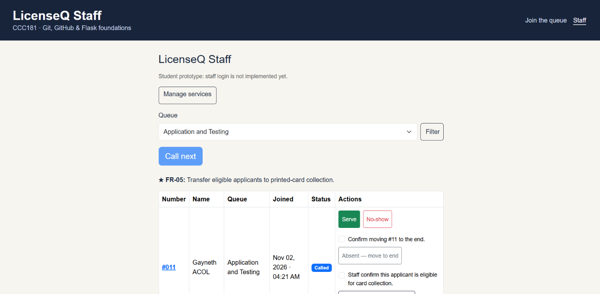
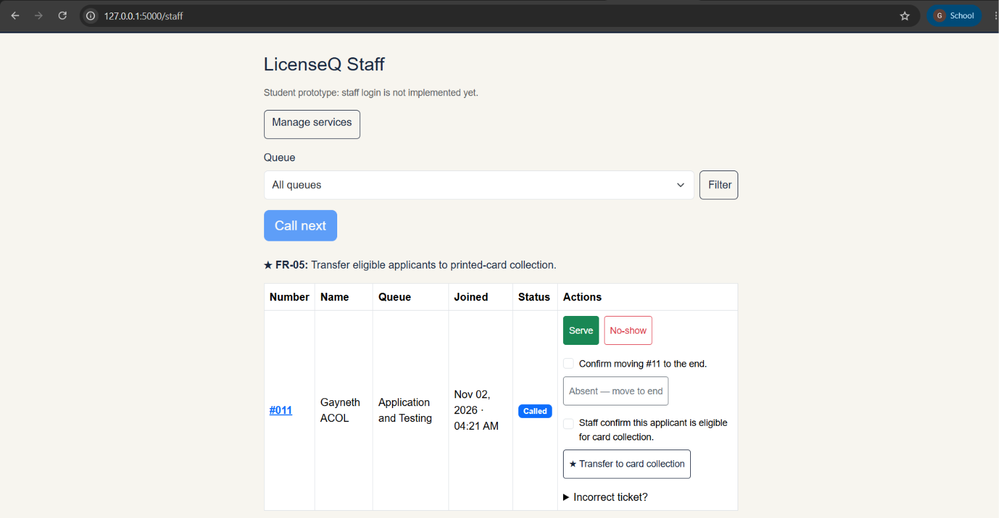

# LicenseQ — PostgreSQL Persistence Test

All five tickets kept their IDs, services, and statuses after the PostgreSQL container was removed and recreated. Ticket #011 was still marked **Called** on the Staff dashboard.

## How I tested persistence

I ran the SQL query below before and after the restart. I stopped Flask, ran `docker compose down`, and checked `docker compose ps`. It showed no running containers. I then ran `docker compose up -d` and waited until `docker compose ps` showed the database was healthy.

PostgreSQL reused the named volume `ccc181_postgres_data`, which contained the saved records.

```sql
SELECT t.id, s.name AS service, t.status
FROM tickets AS t
JOIN services AS s ON s.id = t.service_id
ORDER BY t.id;
```

## SQL results

| Ticket ID | Service before and after | Status before | Status after |
|---|---|---|---|
| 1 | Application and Testing | no-show | no-show |
| 2 | Application and Testing | no-show | no-show |
| 3 | Application and Testing | left | left |
| 4 | Printed-Card Collection | served | served |
| 11 | Application and Testing | called | called |

Both queries returned the same 5 rows.

## Staff dashboard before restart



## Staff dashboard after restart



The dashboard shows only waiting or called tickets. Ticket #011 was the only active ticket, while PostgreSQL retained all five records.

## Clean database rebuild

After saving the restart evidence, I ran `docker compose down -v` to remove the database volume. I ran `docker compose up -d` to create a fresh volume, waited for PostgreSQL to become healthy, and applied the migrations. Then I ran `seed.py`, which reported `Seeding complete. Added 2 service(s).`

I checked the rebuilt database with these queries:

```sql
SELECT id, name, active FROM services ORDER BY id;
SELECT COUNT(*) FROM tickets;
```

| Service ID | Service | Active |
|---|---|---|
| 1 | Application and Testing | Yes |
| 2 | Printed-Card Collection | Yes |

The ticket count was **0**. With a fresh volume, the migrations recreated the tables and the seed script restored both active licensing services.