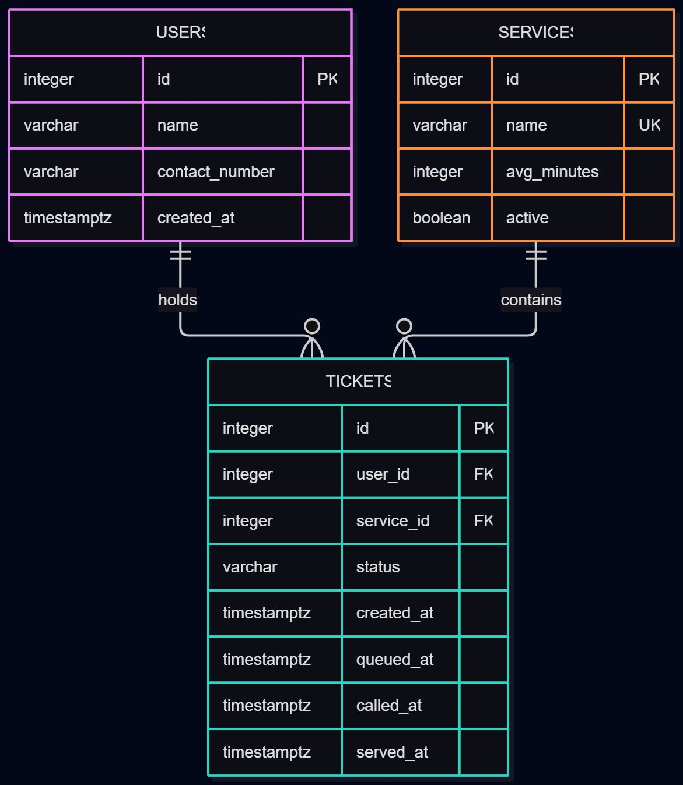
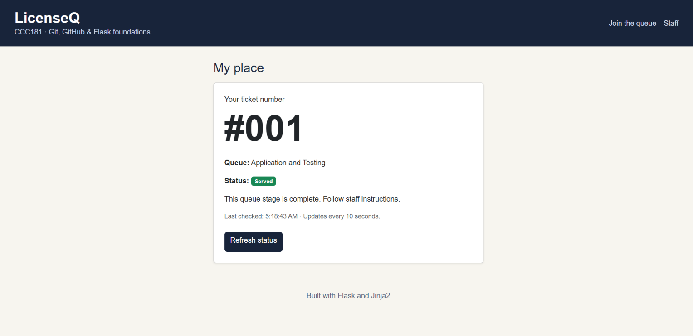
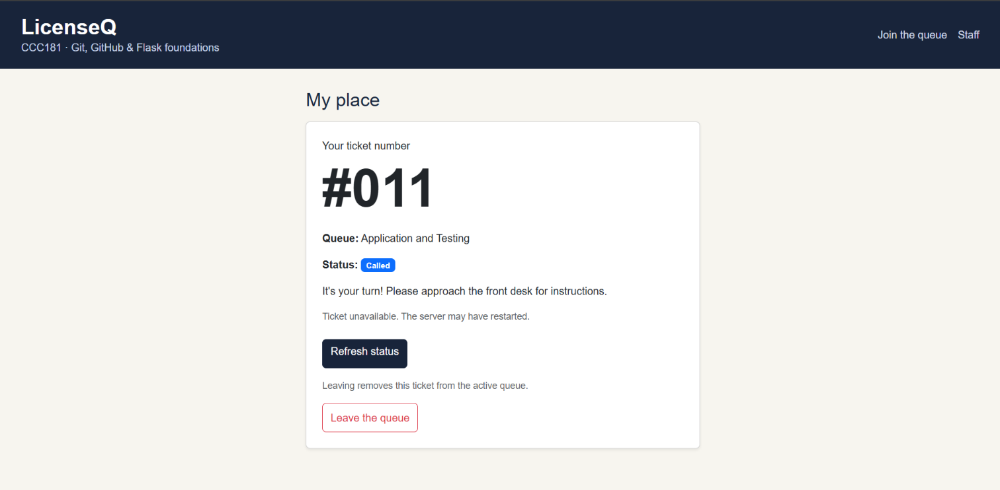
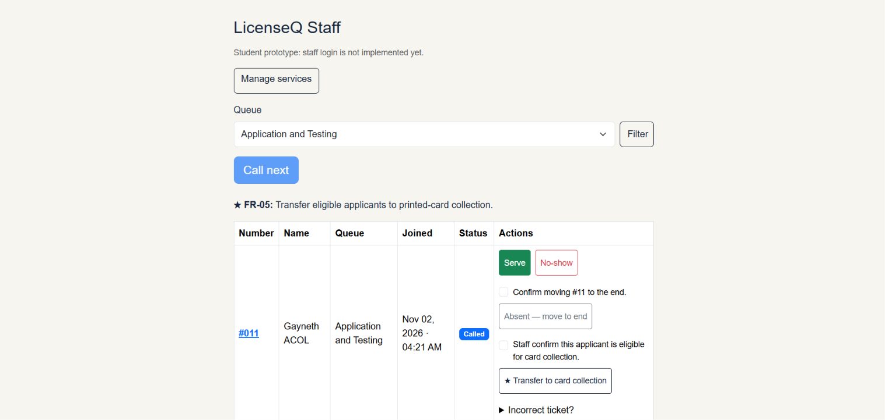
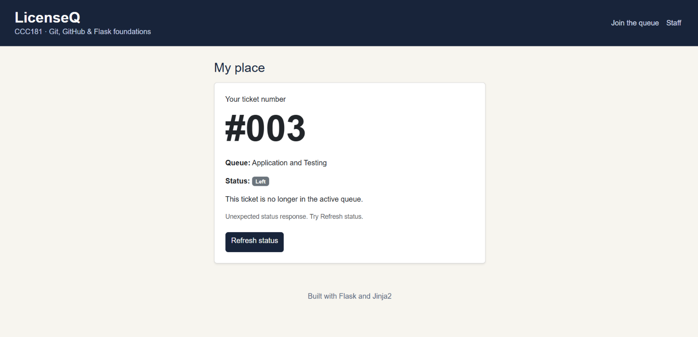
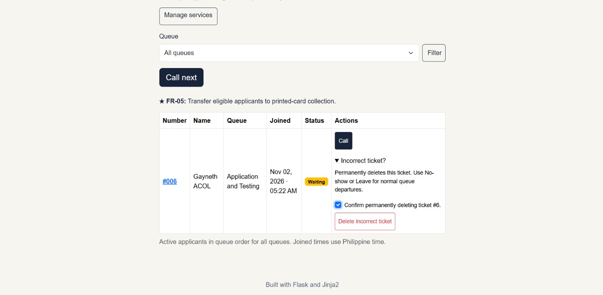
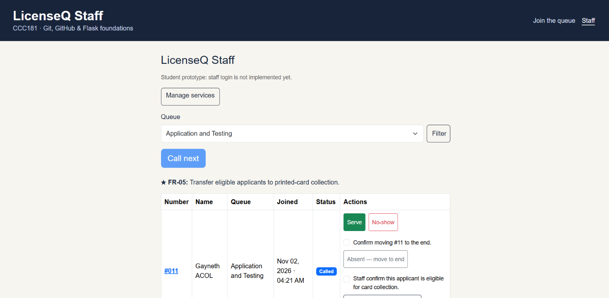
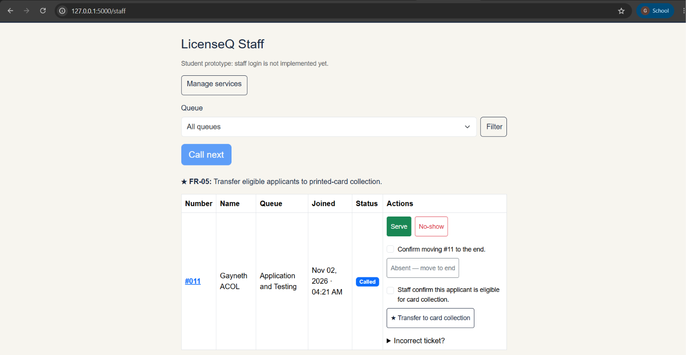

# LicenseQ — Week 4 PostgreSQL Report

## 1. Title details

| Detail | Information |
|---|---|
| Application | LicenseQ |
| Setting | Land Transportation Office (LTO), Tubod, Iligan City |
| Student | Gayneth A. Acol |
| Student ID | 2024-1992 |
| Section | CS3A |
| Date | November 2, 2026 |
| Database | PostgreSQL 17 running in Docker |
| GitHub issue | [Week 4 database work — Issue #3](https://github.com/gaynethacol/CCC181/issues/3) |
| Pull request | [View Week 4 pull request](https://github.com/gaynethacol/CCC181/pull/4) |

LicenseQ manages two queues: **Application and Testing** and **Printed-Card Collection**. In Week 3, tickets were stored in a Python list and disappeared when Flask restarted. In Week 4, I moved the records into PostgreSQL and verified that applicants could reopen the same ticket after a restart.

## 2. Requirements

I documented **17 functional requirements** and **9 non-functional requirements**. The MVP covers FR-01 through FR-05 and FR-09 through FR-16.

| MVP requirements | What the app must do |
|---|---|
| FR-01–FR-02 | Let an applicant join a queue, receive a ticket, and see its status and position. |
| FR-03–FR-05 | Maintain separate licensing queues, let staff call applicants and record outcomes, and transfer eligible applicants to card collection. |
| FR-09 | Preserve tickets so applicants can reopen them after a restart. |
| FR-10–FR-13 | Let staff create, edit, and deactivate services, and delete a service when it has no linked tickets. |
| FR-14–FR-16 | Let an applicant leave, let staff delete an incorrect ticket with confirmation, and move an absent applicant to the end of the queue. |

The reviewer identified joining the queue and receiving a ticket as the most important functions. Both were already included in FR-01. The reviewer did not identify anything missing or incorrect, so I kept the existing MVP priorities. Estimated waiting time and SMS notifications remain outside the current MVP.

[Full requirements and reviewer feedback](../requirements.md)

## 3. Entity-relationship diagram



- One applicant can have many tickets. Each ticket belongs to one applicant through `tickets.user_id`.
- One service can have many tickets. Each ticket belongs to one current service through `tickets.service_id`.
- When staff transfer an applicant to Printed-Card Collection, the ticket keeps its ID and references the destination service.

[Database design and column descriptions](schema.md)

## 4. Schema

I inspected the rebuilt database using PostgreSQL’s `\d` command.

### Users

Output of `\d users`:

```text
                                         Table "public.users"
     Column     |           Type           | Collation | Nullable |              Default
----------------+--------------------------+-----------+----------+-----------------------------------
 id             | integer                  |           | not null | nextval('users_id_seq'::regclass)
 name           | character varying(100)   |           | not null |
 contact_number | character varying(11)    |           | not null |
 created_at     | timestamp with time zone |           | not null | now()
Indexes:
    "users_pkey" PRIMARY KEY, btree (id)
Check constraints:
    "ck_users_contact_number_format" CHECK (contact_number::text ~ '^09[0-9]{9}$'::text)
    "ck_users_name_not_blank" CHECK (length(btrim(name::text)) > 0)
Referenced by:
    TABLE "tickets" CONSTRAINT "tickets_user_id_fkey" FOREIGN KEY (user_id) REFERENCES users(id) ON DELETE RESTRICT
```

### Services

Output of `\d services`:

```text
                                      Table "public.services"
   Column    |          Type          | Collation | Nullable |               Default
-------------+------------------------+-----------+----------+--------------------------------------
 id          | integer                |           | not null | nextval('services_id_seq'::regclass)
 name        | character varying(100) |           | not null |
 avg_minutes | integer                |           | not null |
 active      | boolean                |           | not null | true
Indexes:
    "services_pkey" PRIMARY KEY, btree (id)
    "uq_services_name" UNIQUE CONSTRAINT, btree (name)
Check constraints:
    "ck_services_avg_minutes_positive" CHECK (avg_minutes > 0)
    "ck_services_name_not_blank" CHECK (length(btrim(name::text)) > 0)
Referenced by:
    TABLE "tickets" CONSTRAINT "tickets_service_id_fkey" FOREIGN KEY (service_id) REFERENCES services(id) ON DELETE RESTRICT
```

### Tickets

Output of `\d tickets`:

```text
                                       Table "public.tickets"
   Column   |           Type           | Collation | Nullable |               Default
------------+--------------------------+-----------+----------+-------------------------------------
 id         | integer                  |           | not null | nextval('tickets_id_seq'::regclass)
 user_id    | integer                  |           | not null |
 service_id | integer                  |           | not null |
 status     | character varying(20)    |           | not null | 'waiting'::character varying
 created_at | timestamp with time zone |           | not null | now()
 queued_at  | timestamp with time zone |           | not null | now()
 called_at  | timestamp with time zone |           |          |
 served_at  | timestamp with time zone |           |          |
Indexes:
    "tickets_pkey" PRIMARY KEY, btree (id)
    "ix_tickets_service_id" btree (service_id)
    "ix_tickets_user_id" btree (user_id)
Check constraints:
    "ck_tickets_status" CHECK (status::text = ANY (ARRAY['waiting'::character varying, 'called'::character varying, 'served'::character varying, 'no-show'::character varying, 'left'::character varying]::text[]))
Foreign-key constraints:
    "tickets_service_id_fkey" FOREIGN KEY (service_id) REFERENCES services(id) ON DELETE RESTRICT
    "tickets_user_id_fkey" FOREIGN KEY (user_id) REFERENCES users(id) ON DELETE RESTRICT
```

## 5. Design decisions

1. **Keep the ticket number stable and calculate the position.** Under FR-01, applicants need a ticket they can return to. Under FR-02, they need to know how many people are ahead. LicenseQ keeps the same ticket ID and counts earlier waiting tickets in the same service. Calling one person moves the others forward without changing their ticket numbers.
2. **Record original arrival and current queue entry separately.** `created_at` preserves when the applicant first joined. `queued_at` changes when staff transfer someone to card collection under FR-05 or move an absent applicant to the end under FR-16. This prevents a transferred applicant from jumping ahead of people already waiting at the next stage.
3. **Record leaving and missing a call as different outcomes.** Under FR-14, an applicant who leaves receives the status `left`. Under FR-04, staff can mark a called applicant `no-show`. Both actions remove the ticket from the active dashboard while preserving what happened.

## 6. Self-review

| Problem considered | Decision after review |
|---|---|
| Family members may share a contact number. | Give each applicant a generated ID. Validate the contact number’s format and allow the number to appear on more than one applicant record. |
| Sorting by original arrival could give a transferred applicant the wrong position. | Sort tickets in each service by `queued_at`, then by `id` to break ties. |
| Deleting a service with linked tickets could break existing records. | Use `ON DELETE RESTRICT`. Staff can deactivate the service while keeping its tickets. |
| A stored queue position would become outdated after people leave or are called. | Calculate the number ahead when displaying My place. |

The schema and ERD already supported these decisions, so I kept the diagram after the review.

[Full schema self-review](schema-review.md)

## 7. Migrations

| Revision | What it does |
|---|---|
| `eac906577308` | Creates `users`, `services`, and `tickets`, including their keys, validation constraints, and indexes on the ticket foreign keys. |
| `cc53d09f56a9` | Adds `services.active` as a required Boolean with a database default of `true`, making existing services available when the migration is applied. |

I tested the second migration by applying it, downgrading to `eac906577308`, and applying it again. PostgreSQL showed both licensing services as active afterward. Running the seed script twice also confirmed that it does not duplicate the services.

[Migration files](../../migrations/versions/)

## 8. CRUD operations

### Create — Join a queue

**Requirement:** FR-01  
**Route:** `POST /join`

The applicant enters their name and contact number, chooses an active service, and clicks **Get a ticket**. LicenseQ saves the ticket and opens **My place** with a confirmation message. If the same name and contact number already have a waiting or called ticket for that service, LicenseQ reopens it.



### Read — View My place

**Requirement:** FR-02  
**Route:** `GET /queue/<ticket_id>`

The applicant opens **My place** to see their ticket number, service, and status. A waiting applicant also sees their position and how many people are ahead. The screenshot shows ticket **#011** after it was called.



### Update — Call the next applicant

**Requirement:** FR-04  
**Route:** `POST /staff/call-next`

Staff select a queue and click **Call next**. LicenseQ changes the first waiting ticket in that queue to `called` and records the call time. The applicant’s **My place** page checks for the change every 10 seconds.



### Soft delete — Leave the queue

**Requirement:** FR-14  
**Route:** `POST /queue/<ticket_id>/leave`

A waiting applicant clicks **Leave the queue**. LicenseQ changes the ticket’s status to `left` and removes it from the active staff list. The applicant can still open the same ticket URL and see **Left**.



### Hard delete — Remove an incorrect ticket

**Requirement:** FR-15  
**Route:** `POST /staff/tickets/<ticket_id>/delete`

Staff find the incorrect ticket, expand **Incorrect ticket?**, tick the confirmation box, and click **Delete incorrect ticket**. LicenseQ deletes the ticket from PostgreSQL and displays a confirmation. Opening the deleted ticket’s URL returns `404 Not Found`.



## 9. Validation

I tested validation at three layers.

| Layer | Test and result |
|---|---|
| Browser | Chrome blocked submission for an empty name, the invalid contact number `123`, and an unselected queue. |
| Flask | I bypassed the browser with three curl requests. An empty name, an invalid contact number, and a missing service ID each returned `HTTP 400`. The ticket count was **5 before and 5 after**. |
| PostgreSQL | Direct SQL tests rejected a missing service reference, an invalid ticket status, a duplicate service name, a zero-minute duration, a null applicant name, and deletion of a referenced service. A valid insert generated a ticket number and timestamps and defaulted to `waiting`. |

The most useful PostgreSQL error came from trying to delete a service with tickets:

```text
ERROR:  update or delete on table "services" violates foreign key constraint "tickets_service_id_fkey" on table "tickets"
DETAIL:  Key (id)=(1) is still referenced from table "tickets".
```

This explains why a staff member can **deactivate** a service with tickets. Deactivation closes it to new applicants and preserves the records that refer to it.

[Validation commands, results, and PostgreSQL errors](validation.md)

## 10. Persistence

**NFR-05 passed.** I compared the same query before and after removing and recreating the PostgreSQL container while keeping its named volume.

| Ticket ID | Service | Before restart | After restart |
|---|---|---|---|
| 1 | Application and Testing | no-show | no-show |
| 2 | Application and Testing | no-show | no-show |
| 3 | Application and Testing | left | left |
| 4 | Printed-Card Collection | served | served |
| 11 | Application and Testing | called | called |

Both queries returned the same five records. The Staff dashboard showed ticket **#011** as **Called** before and after the restart. It was the only active ticket.

### Before restart



### After restart



I also tested a clean rebuild. I removed the database volume with `docker compose down -v`, started PostgreSQL, applied both migrations, and ran `seed.py`. The script added **2 services**. Application and Testing and Printed-Card Collection were both active, and the rebuilt database had **0 tickets**.

[Persistence query, screenshots, and rebuild results](persistence.md)

## 11. Reflection

The hardest part for me was connecting the database models to the existing screens. A ticket could be saved successfully while My place still showed an error. The traceback pointed to `ticket.number` in the template. The database model used `ticket.id`. Fixing the saved template let the page display the ticket that was already in PostgreSQL.

FR-02 was the hardest requirement to make testable because “show my place” could mean either the ticket number or the current position. I tested it with two applicants in Application and Testing and one in Printed-Card Collection. Calling the first application ticket moved the second applicant forward. The card-collection applicant’s position stayed the same.

For Week 5, I would like to answer this question for the front-desk employee: **For each service and each Philippine calendar day, how many tickets created that day have the status served, left, or no-show?** This would help staff distinguish completed visits from applicants who left or missed their call.

## 12. Declaration

I used ChatGPT to help adapt Flask routes and Jinja templates, troubleshoot errors, prepare validation commands, and organize this report. I used the CCC181 Week 4 activity and the Week 2 starter as course references. I ran the app, migrations, database queries, and restart tests on my laptop.