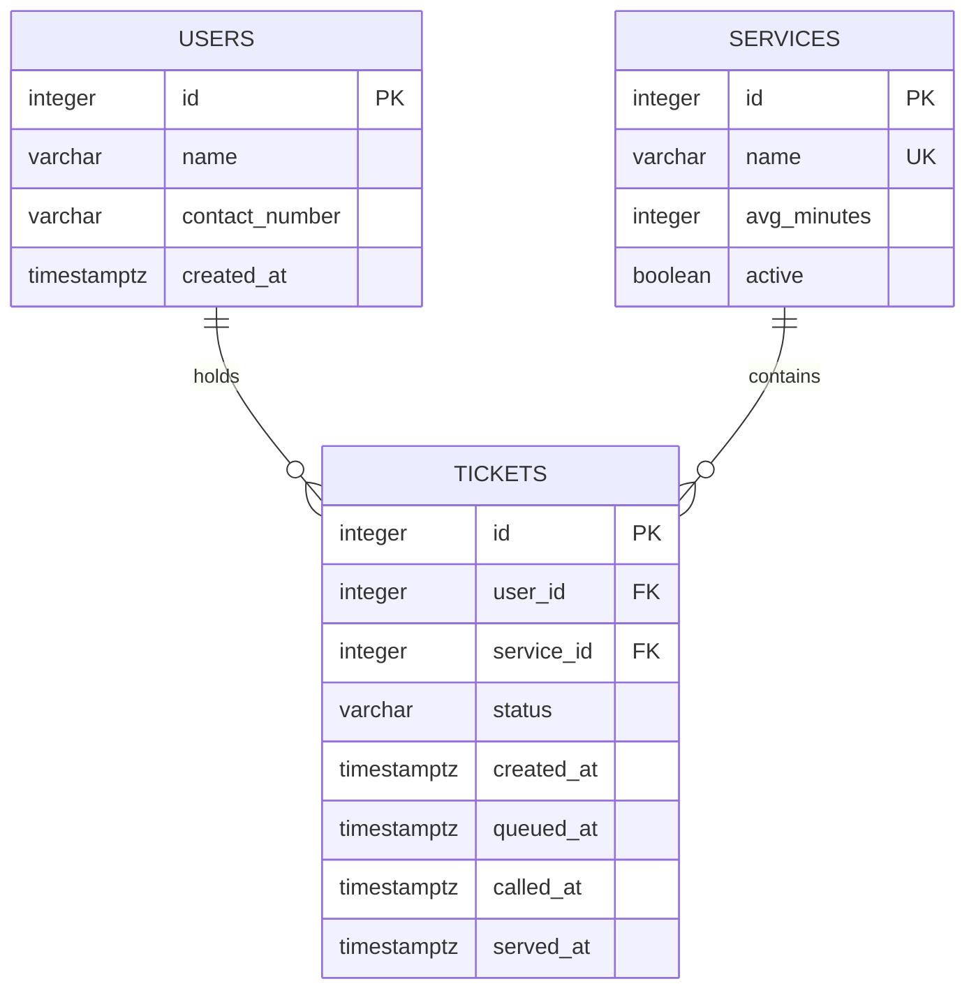
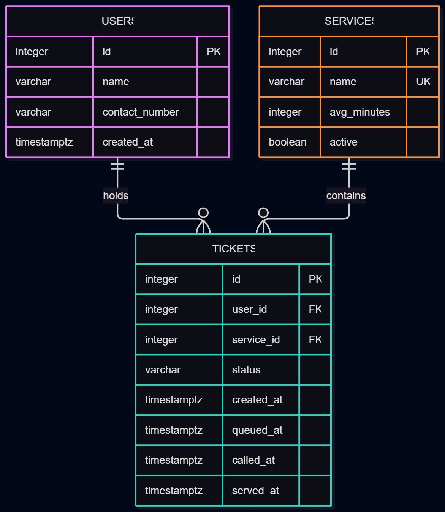

# LicenseQ Database Design

## 1. Requirements and data

LicenseQ manages two queues at LTO Tubod, Iligan City:
Application and Testing, and Printed-Card Collection.

| Requirements | Data needed | Table |
|---|---|---|
| FR-01 | Applicant name, contact number, and ticket | users, tickets |
| FR-02 | Ticket status and queue position | tickets |
| FR-03 | Separate licensing services | services, tickets |
| FR-04 | Call, serve, and no-show outcomes | tickets |
| FR-05 | Transfer an eligible applicant to card collection | tickets |
| FR-09 | Preserve queue records after restarting | All tables |
| FR-10–FR-13 | Create, edit, deactivate, and delete unused services | services |
| FR-14 | Leave the queue while retaining the record | tickets |
| FR-15 | Delete an incorrectly created ticket | tickets |
| FR-16 | Move an absent applicant to the end | tickets |
| FR-17 | Display when an applicant joined | tickets |

The main nouns are **applicant**, **service**, and **ticket**.
Applicants are stored in the users table.

Queue position is calculated from waiting tickets in the same
service. It is not stored as a column.

## 2. Tables and columns

### users

Stores applicant details.

| Column | PostgreSQL type | Constraints | Purpose |
|---|---|---|---|
| id | INTEGER | PRIMARY KEY, generated identity | Identifies the applicant |
| name | VARCHAR(100) | NOT NULL; CHECK trimmed value is not empty | Stores the applicant's name |
| contact_number | VARCHAR(11) | NOT NULL; CHECK matches `^09[0-9]{9}$` | Stores an 11-digit mobile number |
| created_at | TIMESTAMPTZ | NOT NULL, DEFAULT CURRENT_TIMESTAMP | Records when the applicant record was created |

Contact numbers are not unique because applicants may share
a family contact number. Names are not unique either.

### services

Stores the queues applicants can join.

| Column | PostgreSQL type | Constraints | Purpose |
|---|---|---|---|
| id | INTEGER | PRIMARY KEY, generated identity | Identifies the service |
| name | VARCHAR(100) | NOT NULL, UNIQUE; CHECK trimmed value is not empty | Names the queue |
| avg_minutes | INTEGER | NOT NULL; CHECK greater than 0 | Stores a configurable average service duration |
| active | BOOLEAN | NOT NULL, DEFAULT TRUE | Controls whether new applicants can join |

Initial services:
- Application and Testing
- Printed-Card Collection

Average durations are configuration values, not measured waiting
times. Estimated waiting time is outside the current MVP.

The active column is planned for the second migration required
by the Week 4 activity.

### tickets

Stores each queue entry and its current state.

| Column | PostgreSQL type | Constraints | Purpose |
|---|---|---|---|
| id | INTEGER | PRIMARY KEY, generated identity | Serves as the ticket number |
| user_id | INTEGER | NOT NULL, FOREIGN KEY → users.id, ON DELETE RESTRICT | Identifies the applicant |
| service_id | INTEGER | NOT NULL, FOREIGN KEY → services.id, ON DELETE RESTRICT | Identifies the current queue |
| status | VARCHAR(20) | NOT NULL, DEFAULT 'waiting'; CHECK allowed statuses | Records the ticket's state |
| created_at | TIMESTAMPTZ | NOT NULL, DEFAULT CURRENT_TIMESTAMP | Records the original joining time |
| queued_at | TIMESTAMPTZ | NOT NULL, DEFAULT CURRENT_TIMESTAMP | Determines order in the current queue |
| called_at | TIMESTAMPTZ | Nullable | Records the most recent call |
| served_at | TIMESTAMPTZ | Nullable | Records when service was completed |

Allowed statuses:
- waiting
- called
- served
- no-show
- left

A new ticket starts as waiting.

Leaving voluntarily sets the status to left.
Staff marking an absent applicant sets the status to no-show.

Transferring or requeuing a ticket updates queued_at and returns
the ticket to waiting. The original created_at remains unchanged.
called_at and served_at are cleared when starting the new waiting stage.

## 3. Relationships and deletion rules

- One user can have many tickets.
- Each ticket belongs to exactly one user.
- One service can have many tickets.
- Each ticket belongs to exactly one current service.

Deleting a user with tickets is blocked by ON DELETE RESTRICT.
Deleting a service with tickets is also blocked.

A service with historical tickets should be deactivated instead
of deleted.

Deleting an incorrect ticket does not delete its user or service.
The staff interface requires confirmation before deleting a ticket.

## 4. Queue order and position

Waiting tickets are ordered by queued_at, then id to break ties.

People ahead are tickets that:
1. Belong to the same service.
2. Have the status waiting.
3. Come earlier in that ordering.

For a waiting ticket:

Position = number of waiting people ahead + 1.

Position is not displayed for called, served, no-show, or left tickets.

## 5. Time handling

Timestamps use TIMESTAMPTZ.

The application displays dates and times in Asia/Manila.
Original joining time and current queue-entry time are separate
so transfers and requeuing do not overwrite the original arrival.

## 6. Normalization

### First normal form — 1NF

Each column contains one value. Each row has a primary key.
Services and tickets are not stored as lists inside user records.

### Second normal form — 2NF

Every table uses a single-column primary key.
Non-key columns describe the record identified by that key.

### Third normal form — 3NF

Applicant details are stored in users, and service details are
stored in services. Tickets reference those records using foreign
keys instead of repeating names and contact numbers.

Queue position is calculated rather than stored, avoiding
outdated position values.

## 7. Entity-relationship diagram

Each ticket belongs to one applicant and one service.
An applicant or service can have zero or many tickets.

